<picture>
  <source media="(prefers-reduced-motion: reduce) and (max-width: 600px)" srcset="assets/hero-mobile-static.svg" />
  <source media="(prefers-reduced-motion: reduce)" srcset="assets/hero-static.svg" />
  <source media="(max-width: 600px)" srcset="assets/hero-mobile.svg" />
  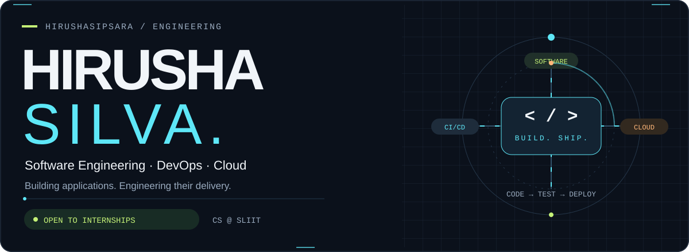
</picture>

<p align="center">
  <a href="#about">About</a> &nbsp; / &nbsp;
  <a href="#selected-work">Selected work</a> &nbsp; / &nbsp;
  <a href="#toolbox">Toolbox</a> &nbsp; / &nbsp;
  <a href="#engineering-journey">Journey</a> &nbsp; / &nbsp;
  <a href="https://www.linkedin.com/in/hirusha-silva">LinkedIn ↗</a>
</p>

<picture>
  <source media="(prefers-reduced-motion: reduce) and (max-width: 600px)" srcset="assets/workspace-scene-mobile-static.svg" />
  <source media="(prefers-reduced-motion: reduce)" srcset="assets/workspace-scene-static.svg" />
  <source media="(max-width: 600px)" srcset="assets/workspace-scene-mobile.svg" />
  
</picture>

## About

I'm **Hirusha**, a third-year **BSc (Hons) Computer Science undergraduate at SLIIT**. I build backend services and full-stack applications, alongside the cloud infrastructure and automated pipelines used to deliver them.

My work spans **Java distributed systems, C#/.NET microservices, React applications, and Python APIs**. University projects, hackathons, and the **IEEE Young Protégé 2026 DevOps mentorship** give me room to put these skills into practice.

> **My focus:** develop useful software, test its behaviour, and understand how it operates after deployment.

<picture>
<source media="(prefers-reduced-motion: reduce) and (max-width: 600px)" srcset="assets/pipeline-mobile-static.svg" />
<source media="(prefers-reduced-motion: reduce)" srcset="assets/pipeline-static.svg" />
<source media="(max-width: 600px)" srcset="assets/pipeline-mobile.svg" />
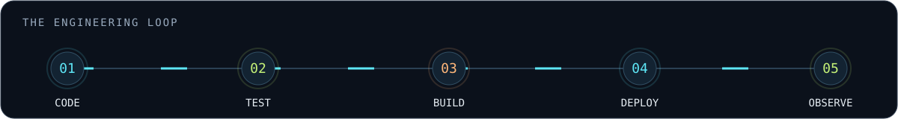
</picture>

## Selected work

Application engineering and cloud delivery, with my contributions identified for collaborative projects.

<table>
<tr>
<td width="50%" valign="top">
<a href="https://github.com/ASSMS-Team/assms-dispatch-service"><picture><source media="(prefers-reduced-motion: reduce) and (max-width: 600px)" srcset="assets/assms-mobile-static.svg" /><source media="(prefers-reduced-motion: reduce)" srcset="assets/assms-static.svg" /><source media="(max-width: 600px)" srcset="assets/assms-mobile.svg" />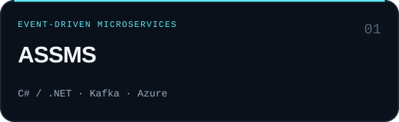</picture></a>
<p>Technician assignment with workload-based selection and a transactional outbox.</p>
<p><b>My work:</b> Dispatch implementation, Azure infrastructure, and CI/CD.</p>
<a href="https://github.com/ASSMS-Team/assms-dispatch-service">Explore repository ↗</a>
</td>
<td width="50%" valign="top">
<a href="https://github.com/SachiniKK/fault-tolerant-distributed-payment-processing-system"><picture><source media="(prefers-reduced-motion: reduce) and (max-width: 600px)" srcset="assets/raft-mobile-static.svg" /><source media="(prefers-reduced-motion: reduce)" srcset="assets/raft-static.svg" /><source media="(max-width: 600px)" srcset="assets/raft-mobile.svg" />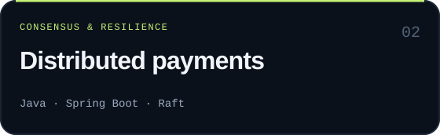</picture></a>
<p>A team-built payment system exploring distributed coordination.</p>
<p><b>My work:</b> Raft elections, log replication, majority commits, and the demo dashboard.</p>
<a href="https://github.com/SachiniKK/fault-tolerant-distributed-payment-processing-system">Explore repository ↗</a>
</td>
</tr>
<tr>
<td width="50%" valign="top">
<a href="https://github.com/VimukthiHerath/Lanka-Fix-SaaS"><picture><source media="(prefers-reduced-motion: reduce) and (max-width: 600px)" srcset="assets/lankafix-mobile-static.svg" /><source media="(prefers-reduced-motion: reduce)" srcset="assets/lankafix-static.svg" /><source media="(max-width: 600px)" srcset="assets/lankafix-mobile.svg" /></picture></a>
<p>A services marketplace with customer, worker, and admin workflows.</p>
<p><b>My work:</b> UI/UX, frontend development, error handling, Gemini integration, and a separate Google Cloud deployment.</p>
<a href="https://github.com/VimukthiHerath/Lanka-Fix-SaaS">Explore repository ↗</a>
</td>
<td width="50%" valign="top">
<a href="https://github.com/HirushaSipsara/certifylk"><picture><source media="(prefers-reduced-motion: reduce) and (max-width: 600px)" srcset="assets/certifylk-mobile-static.svg" /><source media="(prefers-reduced-motion: reduce)" srcset="assets/certifylk-static.svg" /><source media="(max-width: 600px)" srcset="assets/certifylk-mobile.svg" />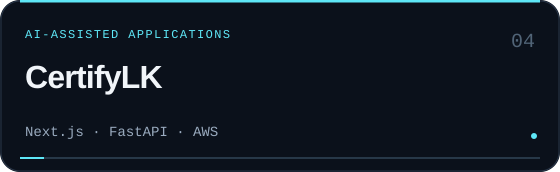</picture></a>
<p>Certification readiness guidance for Sri Lankan food manufacturers.</p>
<p><b>My work:</b> Application development, backend assessment behaviour, and DevOps.</p>
<a href="https://github.com/HirushaSipsara/certifylk">Explore repository ↗</a>
</td>
</tr>
<tr>
<td width="50%" valign="top">
<a href="https://github.com/HirushaSipsara/devops-knowledge-base/tree/Dev"><picture><source media="(prefers-reduced-motion: reduce) and (max-width: 600px)" srcset="assets/knowledge-mobile-static.svg" /><source media="(prefers-reduced-motion: reduce)" srcset="assets/knowledge-static.svg" /><source media="(max-width: 600px)" srcset="assets/knowledge-mobile.svg" />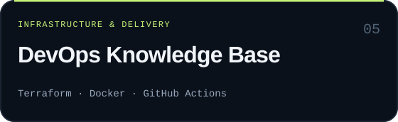</picture></a>
<p>A FastAPI/PostgreSQL application for commands, tools, and snippets.</p>
<p><b>My work:</b> CI/CD, containers, and Terraform for EC2 with S3 remote-state configuration.</p>
<a href="https://github.com/HirushaSipsara/devops-knowledge-base/tree/Dev">Explore repository ↗</a>
</td>
<td width="50%" valign="top">
<a href="https://github.com/HirushaSipsara/Skybreak"><picture><source media="(prefers-reduced-motion: reduce) and (max-width: 600px)" srcset="assets/skybreak-mobile-static.svg" /><source media="(prefers-reduced-motion: reduce)" srcset="assets/skybreak-static.svg" /><source media="(max-width: 600px)" srcset="assets/skybreak-mobile.svg" />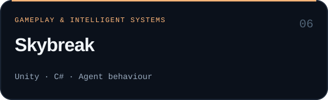</picture></a>
<p>A Unity/C# team project with combat, mission flow, navigation, and intelligent agents.</p>
<p>Coursework in Graphics &amp; Visualization and Intelligent Systems.</p>
<a href="https://github.com/HirushaSipsara/Skybreak">Explore repository ↗</a>
</td>
</tr>
</table>

**Also built:** [CareerLens](https://github.com/HirushaSipsara/CareerLens), a React/Flask career recommendation application with Docker, Terraform, CI/CD, and monitoring configuration.

<details>
<summary><b>Read the project details, contributions, and architecture links</b></summary>


### ASSMS: Asset & Service Management System

A team project with .NET microservices, a React frontend, Kafka messaging, and MySQL. The Dispatch service selects an eligible technician using workload-based assignment and publishes assignment events through a transactional outbox.

My contributions include the Dispatch assignment and outbox implementation, alongside Terraform infrastructure and GitHub Actions deployment work for Azure staging.

[Dispatch service](https://github.com/ASSMS-Team/assms-dispatch-service) · [React frontend](https://github.com/ASSMS-Team/assms-frontend) · [Cloud infrastructure](https://github.com/ASSMS-Team/assms-platform-infrastructure)

### Fault-tolerant distributed payment system

A university team project using Java 17 and Spring Boot to explore payment processing across distributed services.

I implemented the Raft consensus component, including leader election, voting, log replication, and majority-based commit. I also worked on its API and browser-based demonstration dashboard.

[Repository and architecture](https://github.com/SachiniKK/fault-tolerant-distributed-payment-processing-system)

### LankaFix: Local services marketplace

A team-built marketplace connecting service seekers and skilled workers, with customer, worker, and administrator workflows. The application uses React, Tailwind CSS, Spring Boot, and PostgreSQL.

My work includes frontend development, UI/UX, and error handling across the frontend and backend. I also contributed the Gemini-assisted description feature and completed a separate deployment exercise using Firebase Hosting, Google App Engine, and Neon PostgreSQL.

[Team repository](https://github.com/VimukthiHerath/Lanka-Fix-SaaS) · [My fork](https://github.com/HirushaSipsara/Lanka-Fix-SaaS)

### CertifyLK: Certification readiness platform

A team project providing AI-assisted readiness guidance for small Sri Lankan food manufacturers. It combines a Next.js and TypeScript frontend with FastAPI, PostgreSQL, and Gemini integration.

My contributions span application development and DevOps, including backend assessment behaviour. The repository includes automated tests, Docker configuration, GitHub Actions workflows, and Terraform for AWS.

[Repository and technical documentation](https://github.com/HirushaSipsara/certifylk)

### DevOps Knowledge Base

A collaborative IEEE Young Protégé 2026 project for managing DevOps commands, tools, and snippets. The application uses FastAPI, SQLAlchemy, and PostgreSQL, with CRUD operations, search, tests, and a metrics endpoint.

My work focuses on CI/CD, containerisation, and Terraform infrastructure. The Dev branch contains the GitHub Actions workflow for testing and deploying to AWS EC2, with S3 remote-state configuration.

[Implementation and deployment documentation](https://github.com/HirushaSipsara/devops-knowledge-base/tree/Dev)

### More engineering work

- [Skybreak: The Descent](https://github.com/HirushaSipsara/Skybreak): A Unity and C# team project with gameplay systems, intelligent agents, navigation, and mission flow.
- [CareerLens](https://github.com/HirushaSipsara/CareerLens): A career recommendation application combining React and Flask with Docker, Terraform, GitHub Actions, and Prometheus/Grafana configuration.


</details>

## Toolbox

**Languages**

<p>
<picture><source media="(prefers-reduced-motion: reduce)" srcset="assets/tech-0-0-static.svg" /></picture>
<picture><source media="(prefers-reduced-motion: reduce)" srcset="assets/tech-0-1-static.svg" /></picture>
<picture><source media="(prefers-reduced-motion: reduce)" srcset="assets/tech-0-2-static.svg" />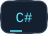</picture>
<picture><source media="(prefers-reduced-motion: reduce)" srcset="assets/tech-0-3-static.svg" /></picture>
<picture><source media="(prefers-reduced-motion: reduce)" srcset="assets/tech-0-4-static.svg" /></picture>
<picture><source media="(prefers-reduced-motion: reduce)" srcset="assets/tech-0-5-static.svg" />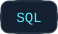</picture>
</p>

**Application engineering**

<p>
<picture><source media="(prefers-reduced-motion: reduce)" srcset="assets/tech-1-0-static.svg" />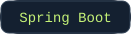</picture>
<picture><source media="(prefers-reduced-motion: reduce)" srcset="assets/tech-1-1-static.svg" /></picture>
<picture><source media="(prefers-reduced-motion: reduce)" srcset="assets/tech-1-2-static.svg" />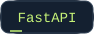</picture>
<picture><source media="(prefers-reduced-motion: reduce)" srcset="assets/tech-1-3-static.svg" />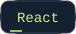</picture>
<picture><source media="(prefers-reduced-motion: reduce)" srcset="assets/tech-1-4-static.svg" /></picture>
<picture><source media="(prefers-reduced-motion: reduce)" srcset="assets/tech-1-5-static.svg" /></picture>
<picture><source media="(prefers-reduced-motion: reduce)" srcset="assets/tech-1-6-static.svg" /></picture>
<picture><source media="(prefers-reduced-motion: reduce)" srcset="assets/tech-1-7-static.svg" /></picture>
</p>

**Cloud & delivery**

<p>
<picture><source media="(prefers-reduced-motion: reduce)" srcset="assets/tech-2-0-static.svg" /></picture>
<picture><source media="(prefers-reduced-motion: reduce)" srcset="assets/tech-2-1-static.svg" /></picture>
<picture><source media="(prefers-reduced-motion: reduce)" srcset="assets/tech-2-2-static.svg" /></picture>
<picture><source media="(prefers-reduced-motion: reduce)" srcset="assets/tech-2-3-static.svg" /></picture>
<picture><source media="(prefers-reduced-motion: reduce)" srcset="assets/tech-2-4-static.svg" />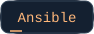</picture>
<picture><source media="(prefers-reduced-motion: reduce)" srcset="assets/tech-2-5-static.svg" /></picture>
<picture><source media="(prefers-reduced-motion: reduce)" srcset="assets/tech-2-6-static.svg" /></picture>
</p>

**Quality & observability**

<p>
<picture><source media="(prefers-reduced-motion: reduce)" srcset="assets/tech-3-0-static.svg" /></picture>
<picture><source media="(prefers-reduced-motion: reduce)" srcset="assets/tech-3-1-static.svg" />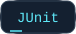</picture>
<picture><source media="(prefers-reduced-motion: reduce)" srcset="assets/tech-3-2-static.svg" /></picture>
<picture><source media="(prefers-reduced-motion: reduce)" srcset="assets/tech-3-3-static.svg" /></picture>
<picture><source media="(prefers-reduced-motion: reduce)" srcset="assets/tech-3-4-static.svg" /></picture>
<picture><source media="(prefers-reduced-motion: reduce)" srcset="assets/tech-3-5-static.svg" /></picture>
</p>

**Foundations:** object-oriented programming · data structures and algorithms · REST APIs · distributed systems · software testing · Agile/Scrum

## Engineering journey


```text
$ whoami --devops-path

[x] Linux fundamentals - shell, permissions, process management
[x] Docker - containerising applications end-to-end
[x] Terraform - infrastructure provisioning (IaC)
[x] Ansible - configuration management and server setup
[x] AWS - EC2, ECR, and IAM role-based authentication
[x] Azure - cloud infrastructure and deployment workflows
[x] Google Cloud - application deployment experience
[x] GitHub Actions - CI/CD pipeline automation
[x] AWS ECS Fargate + RDS - container services and managed databases
[x] Prometheus & Grafana - application metrics and dashboards
[ ] Kubernetes - next learning goal
```


## Contribution activity


<picture>
  <source media="(prefers-color-scheme: dark)" srcset="https://raw.githubusercontent.com/HirushaSipsara/HirushaSipsara/gh-pages/github-contribution-grid-snake-dark.svg" />
  <source media="(prefers-color-scheme: light)" srcset="https://raw.githubusercontent.com/HirushaSipsara/HirushaSipsara/gh-pages/github-contribution-grid-snake.svg" />
  
</picture>


<a href="https://www.linkedin.com/in/hirusha-silva"><picture><source media="(prefers-reduced-motion: reduce)" srcset="assets/footer-static.svg" />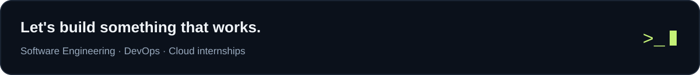</picture></a>

<p align="center"><a href="https://www.linkedin.com/in/hirusha-silva"><b>Connect on LinkedIn ↗</b></a> &nbsp; · &nbsp; <a href="https://github.com/HirushaSipsara?tab=repositories">Browse my repositories</a></p>
